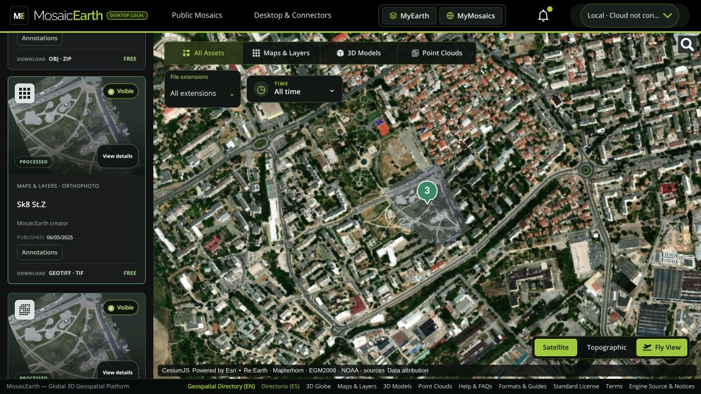
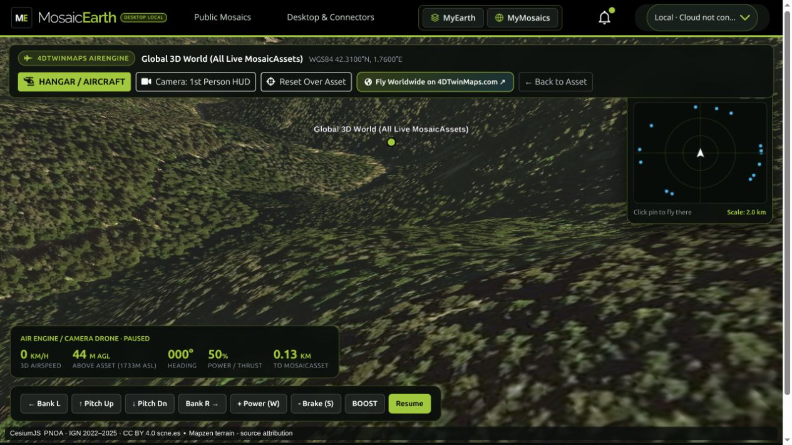

<p align="center">
  
</p>

# MosaicEarth Desktop

**Turn drone imagery into maps and 3D — on your computer.**

Photogrammetry, Gaussian splatting and a geospatial workspace for Windows and Linux. The MosaicEarth web interface runs locally, with your projects, original photographs and finished results on your own disk. Connect to the cloud when you choose to share or synchronize.

[Website](https://mosaicearth.app) · [Public map](https://app.mosaicearth.app/en/Map) · [Install from source](INSTALL_FROM_SOURCE.md) · [Official installers](https://app.mosaicearth.app/en/Desktop) · [Latest release](https://github.com/nsicart/MosaicEarth-Desktop/releases/latest)

<p align="center">
  
</p>

*An actual local source installation, without signing in. The public catalog and basemap use Internet. [Screenshot credits](docs/images/README.md).*

## What you can do

- **Make maps from photographs.** NodeODX/ODX reconstructs orthophotos, elevation models, point clouds and textured meshes. Choose Fast or Complete according to the outputs you need.
- **Reconstruct Gaussian scenes.** COLMAP and OpenSplat turn overlapping imagery into navigable 3D Gaussian models.
- **Organize your work in MyEarth.** Keep projects, surveys, source files and completed products together, with local and cloud storage clearly separated.
- **Compose scenes in MyMosaics.** Combine georeferenced layers and models, inspect them in 3D and explore with Fly View.
- **Use your GPU when compatible.** Automatic mode checks NVIDIA CUDA access inside Docker and selects GPU or CPU for each engine. CPU-only operation remains available; not every processing stage uses the GPU.
- **Synchronize complete projects.** Explicit uploads and downloads include original files, finished products, attachments and metadata, with resumable transfers and SHA-256 verification.
- **Connect your existing tools.** Native connectors support WebODM, OpenDroneMap WebUI and QGIS. Browse Public Map and Public Mosaics through the online catalog.



*Fly View in the local Linux interface. Map credits remain visible: CesiumJS, PNOA/IGN imagery and Mapzen terrain. [Full attribution](https://app.mosaicearth.app/map-sources).*

## Choose how to get started

| | Open-source edition | Official installers |
| --- | --- | --- |
| Get it | Clone this repository and build the local engines. | Download the Windows `.exe` or Linux `.deb`. |
| Local account requirement | **No MosaicEarth account or activation required.** | Purchasing or eligible Studio account; device activation. |
| Interface and processing | Full local interface, NodeODX and OpenSplat, CPU and supported NVIDIA GPU. | The same local interface, with packaged launcher and verified engine downloads. |
| Cloud synchronization | Optional; requires a MosaicEarth cloud account and available storage. | Optional and separate from device activation. |
| Start here | [Step-by-step source installation](INSTALL_FROM_SOURCE.md) | [Windows](INSTALL_WINDOWS.md) · [Linux](INSTALL_LINUX.md) |

Local processing does not consume MosaicEarth cloud processing credits. Official activation supports two active computers and 30 days of local offline operation between activations. Distribution and activation terms do not restrict rights granted by the AGPL source license.

### Quick start from source — Linux

You need an x86-64 Linux computer, Python 3.10 or later, Git, curl, OpenSSL and a running Docker daemon that your user can access. Provisioning downloads and builds the engines, so allow time and disk space; it is not an instant installer.

```bash
git clone https://github.com/nsicart/MosaicEarth-Desktop.git
cd MosaicEarth-Desktop
docker info
./scripts/provision-engines.sh
python3 src/mosaicearth_desktop.py
```

The browser opens the local application. Keep Docker and the launcher running while you work. The provisioning script also prepares the shared interface and verifies its downloaded resources. For **Windows source installation**, prerequisites, CPU-only builds, your first project and troubleshooting, follow [the complete source guide](INSTALL_FROM_SOURCE.md).

## Your data, local and cloud

Originals and local results remain on your computer until you explicitly synchronize them. Cloud copies are private revisions, with integrity verification; synchronization does not silently merge simultaneous edits or propagate deletions to another computer. Preparing a cloud viewer is separate from transferring the completed files.

Local projects and bundled viewers remain usable without a cloud session. Initial setup, public basemaps, the public catalog and cloud transfers need Internet. The bundled NOAA terrain remains available at low resolution when detailed terrain services fail. Background terrain is a visual reference, not a survey-grade vertical datum. Global imagery resolution and age vary by source.

## Built with open-source tools

| Component | Role |
| --- | --- |
| NodeODX / ODX | Photogrammetry and geospatial products. |
| COLMAP / OpenSplat | Camera reconstruction and Gaussian training. |
| CesiumJS | Globe, terrain and georeferenced 3D viewing. |
| GDAL / PROJ | Raster processing and coordinate transformations. |
| Python / FastAPI / SQLite | Local application and project storage. |
| Docker | Isolated local processing environments on Windows and Linux. |

Dependency revisions and notices are included in [third-party licenses](THIRD_PARTY_LICENSES.md) and the [engine dependency manifest](engines/dependencies.txt). Map sources are Re:Earth / Mapterhorn terrain with bundled NOAA polar coverage, OpenStreetMap, Esri World Imagery and PNOA/IGN imagery in Spain, with EOX as an open imagery fallback. Esri imagery is a separate licensed online service, not part of the AGPL source or installer. Public terrain tiles are requested on demand through a bounded MosaicEarth cache, with direct Re:Earth recovery and bundled coarse NOAA terrain if both detailed services fail. Attribution is preserved. See [map services, open-only mode and source-deployment configuration](MAP_SERVICES.md).

## Documentation and help

| I want to… | Read |
| --- | --- |
| Run the free source edition | [Install from source](INSTALL_FROM_SOURCE.md) |
| Install an official package | [Windows](INSTALL_WINDOWS.md) · [Linux](INSTALL_LINUX.md) |
| Check GPU compatibility | [GPU requirements and CPU fallback](GPU.md) |
| Connect WebODM, WebUI or QGIS | [Connector installation and synchronization](CONNECTORS.md) |
| Verify a download | [Checksums and signatures](SIGNING.md) |
| See what was tested | [Release notes and validation scope](RELEASE_NOTES.md) |
| Build packages or contribute | [Build](BUILD.md) · [Contributing and repository map](CONTRIBUTING.md) |
| Report a problem | [GitHub issues](https://github.com/nsicart/MosaicEarth-Desktop/issues) · [Private security reports](SECURITY.md) |

Current release: **0.4.2**, with connectors **0.2.2**. Windows and Linux x86-64 are the supported distribution targets; there is no macOS installer. The Windows trusted-publisher certificate is pending: OpenPGP signatures verify release artifacts but do not remove Windows SmartScreen/unknown-publisher warnings.

MosaicEarth Desktop is licensed under **[AGPL-3.0](LICENSE)**. See [NOTICE](NOTICE) and [third-party licenses](THIRD_PARTY_LICENSES.md) for bundled components. The software license is separate from licenses for user-uploaded data and map imagery.
